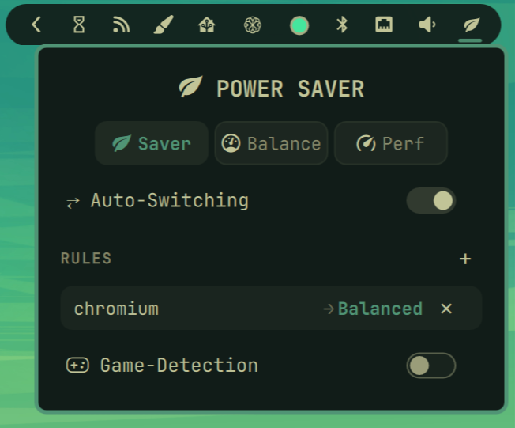

# PPS — Power Profile Switcher (derfleischmann.pps)

A Hyprland bar widget for Omarchy that manages the system power profile over
D-Bus (requires `power-profiles-daemon`). It provides manual switching, per-app
auto-switch rules, and reliable, list-free game detection.



## Features

- **Manual switching** — click to open the popup, right-click to cycle:
  `power-saver` / `balanced` / `performance`.
- **Per-app auto-switch rules** — add a rule mapping an app's `WM_CLASS` to a
  profile; the profile is applied automatically while that app is focused.
- **Auto-switch (optional)** — restore to the last manually chosen profile
  whenever no rule or game applies.
- **Game detection (list-free)** — automatically switches to `performance`
  when a game is running, with **no curated game-title list** needed:
  - **Steam games** are detected at launch via Steam's own `reaper ... AppId=<id>`
    launch marker. This works for both native Linux and Proton/Windows titles
    and holds for the entire play session (even though Steam re-parents the
    game's processes away from the client tree).
  - **Gamescope / Steam-Play windows** are detected from Hyprland's
    `contentType: "game"`.
- **GPU "hold"** — while a detected game is running, the `performance` profile
  is held only while the GPU is actually busy (via `amdgpu` utilization). If the
  game is paused/idle for a sustained moment, the hold is released and the
  last manual profile is restored; resuming gameplay re-engages performance.

## Requirements

- Omarchy (Hyprland shell)
- `power-profiles-daemon`
- `busctl` (systemd — used to read/write the profile; already present on Omarchy)
- `hyprctl` (Hyprland client)
- AMD GPU with the `amdgpu` driver for the GPU-hold feature (optional; the rest
  of the plugin works without it)

## Installation

Place this directory under the Omarchy plugins folder (typically
`~/.config/omarchy/plugins/derfleischmann.pps/`) and enable it in the Omarchy
bar configuration.

## Usage

1. **Enable auto-switch / game detection** in the plugin popup toggles.
2. **Manual cycle** — right-click the bar icon.
3. **Add a rule** — open the popup, enter the app class (see below) and choose a
   profile.

### Finding an app's class for a rule

```sh
hyprctl activewindow -j | jq -r '.class'
```

Rules match the window class case-insensitively as a substring, e.g.
`firefox`, `Steam`, `com.obsproject.Studio`.

## Behavior details

- The displayed icon always tracks the *real* system profile (even changes made
  outside the plugin).
- When auto/game switching is active, closing the triggering app or game
  restores the profile to whichever profile you last chose manually.
- `gameDetect` alone is sufficient for game → performance switching; the
  auto-switch toggle additionally restores to your last manual profile after the
  game ends.

## Tuning

Constants live in `Model.js`:

| Constant | Meaning | Default |
|---|---|---|
| `GPU_FLOOR_PCT` | GPU busy% above which a detected game is "actively gaming" | `10` |
| `GPU_IDLE_RELEASE_STREAK` | Consecutive sub-floor GPU reads before releasing the performance hold | `6` |

## Files

- `BarWidget.qml` — the widget: icon, popup, timers, processes, and switching logic.
- `Model.js` — pure logic (profiles, icons, rules, D-Bus command builders, window parsing, game/GPU detection).
- `manifest.json` — plugin manifest.

## Development

- Hot-reload a single plugin: `omarchy-shell shell rescanPlugins`.
- Validate `Model.js`: `node -e "const m=require('./Model.js'); /* test */"`.
- See `AGENTS.md` for architecture, pitfalls, and reload/verification notes.

### Note on the D-Bus client

The plugin talks to `power-profiles-daemon` with `busctl` rather than
`powerprofilesctl`. That is deliberate — see pitfall 7 in `AGENTS.md`.
